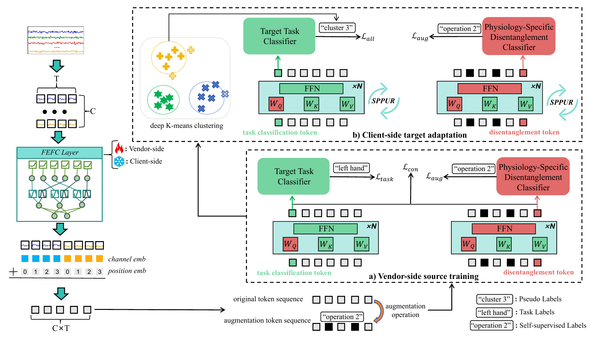

# Source-Free Domain Adaptation based on Physiology-specific Disentanglement for Motor Imagery EEG Classification — Official Implementation

## 1. Paper and Repository

Official implementation of **Source-Free Domain Adaptation based on Physiology-specific Disentanglement for Motor Imagery EEG Classification**.

PSDF is a source-free domain adaptation framework for motor imagery EEG classification across sessions and subjects. It combines Fourier-based EEG token encoding, task classification, and self-supervised augmentation prediction to learn complementary EEG representations. Target adaptation uses an unlabeled target dataset without accessing the source data.

## 2. Code Structure

```text
.
├── assets/
│   └── psdf_architecture.png  # Overall framework from Figure 1 of the paper
├── psdf/
│   ├── __init__.py       # Public model interfaces
│   ├── config.py         # Model configuration
│   ├── embeddings.py     # Sinusoidal temporal position encoding
│   ├── fefc.py           # Fourier-enhanced fully connected layer
│   ├── fmie.py           # EEG token extraction and channel/time encoding
│   ├── attention.py      # Multi-head self-attention
│   ├── backbone.py       # Transformer blocks and shared ViT backbone
│   ├── classifiers.py    # Shared three-layer classifier structure
│   ├── ttc.py            # Target Task Classifier
│   ├── pdc.py            # Physiology-specific Disentanglement Classifier
│   └── model.py          # PSDF assembly and forward computation
├── pyproject.toml        # Package metadata
├── requirements.txt      # Dependencies for the full PSDF workflow
└── README.md
```

## 3. Installation

Create and activate a Conda environment with Python 3.11:

```bash
conda create -n psdf python=3.11 pip -y
conda activate psdf
```

From the repository root, install the dependencies and model package:

```bash
python -m pip install -r requirements.txt
python -m pip install -e .
```

The requirements use PyTorch 2.5.1, torchvision 0.20.1, and timm 1.0.27. For GPU use, install a PyTorch 2.5.1 / torchvision 0.20.1 build compatible with your CUDA driver before running the commands above. NumPy and SciPy support the full workflow's EEG preprocessing, MATLAB dataset loading, and numerical evaluation.

Check that the model package is available:

```bash
python -c "from psdf import PSDFConfig, PSDFModel; print('PSDF import successful')"
```

## 4. Model and Experimental Results

### Model Overview



*Figure 1. Overall PSDF framework: (a) vendor-side source training and (b) client-side source-free target adaptation.*

- **Fourier-enhanced Motor Imagery Encoder (FMIE):** Splits each EEG channel into temporal segments and converts them into spectral-energy representations. The Fourier-enhanced Fully Connected (FEFC) layer applies a learnable sine/cosine feature mapping to produce token embeddings, which are combined with channel and temporal position information.
- **Shared Transformer backbone:** Uses a ViT-Base architecture with 12 Transformer layers, 12 attention heads, and a 768-dimensional embedding space. Separate task and disentanglement tokens provide the representations for the two classifier heads.
- **Target Task Classifier (TTC):** A three-layer classifier that predicts motor imagery categories from the task-token representation.
- **Physiology-specific Disentanglement Classifier (PDC):** A three-layer classifier used for self-supervised augmentation prediction. Token perturbations encourage representations sensitive to EEG variability and complement the task-discriminative features learned by TTC.

The full learning framework described in the paper combines task learning, augmentation prediction, and a bidirectional KL consistency constraint. During target adaptation, the Specificity-driven Progressive Parameter Update Rule (SPPUR) guides differentiated parameter updates using source-referenced parameter changes.

The model accepts preprocessed EEG tensors of shape `[batch, channels, time]`. With four-second trials sampled at 250 Hz and non-overlapping one-second segments, FMIE produces 88 content tokens for BCIC IV 2a and 12 for BCIC IV 2b. The default forward pass returns motor imagery classification logits; the PDC branch is accessed separately. Pretrained ViT initialization can be enabled with `PSDFConfig(pretrained_vit=True)`.

### Results Reported in the Paper

Experiments cover BCI Competition IV 2a (nine subjects, 22 EEG channels, four classes) and BCI Competition IV 2b (nine subjects, three EEG channels, two classes). Cross-session experiments transfer between sessions of the same subject. Cross-subject experiments use single-source transfer between different subjects, covering all 72 directed subject pairs in each dataset. Each task uses 36 unlabeled target samples for adaptation and the remaining target samples for evaluation.

| Dataset | Cross-session accuracy (%) | Cross-subject accuracy (%) |
| :--- | :---: | :---: |
| BCI Competition IV 2a | **84.8 ± 1.9** | **48.5 ± 1.1** |
| BCI Competition IV 2b | **88.2 ± 2.5** | **69.3 ± 1.6** |

Values are the mean accuracy ± standard deviation over five independent runs reported in Tables 1, 3, 4, and 6 of the paper for the full PSDF method.

PSDF achieves the highest mean accuracy among the source-free baselines compared in all four settings. On BCIC IV 2a, the improvements over the strongest source-free baselines are 2.9 percentage points for cross-session transfer and 2.3 percentage points for cross-subject transfer. The corresponding improvements on BCIC IV 2b are 1.5 and 2.2 percentage points.
